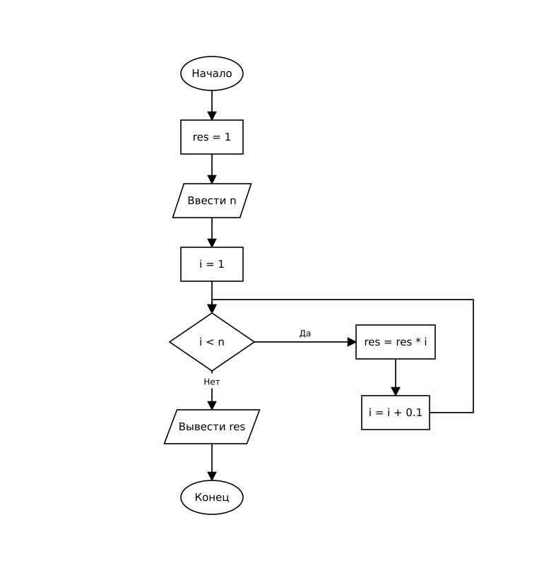

# Домашнее задание к работе 8

## Условие задачи (Вариант 2)

Написать программу для вычисления произведения чисел, начиная от 1 до n с шагом 0.1 (где n вводится пользователем с клавиатуры). Для организации циклического процесса использовать цикл `for`.

---

## 1. Алгоритм и блок-схема

### Алгоритм

1. Настроить русскую локализацию для корректного вывода сообщений.
2. Задать начальное значение произведения: `res = 1`.
3. Запросить у пользователя и ввести вещественное число `n`.
4. Запустить цикл `for` с параметром `i`, начинающимся с 1, шагом `0.1` и условием продолжения `i < n`.
5. На каждом шаге цикла перемножать накопленный результат на текущее значение счетчика: `res = res * i`.
6. После окончания цикла вывести полученное значение `res` на экран.
7. Завершить работу программы.

### Блок-схема



---

## 2. Реализация программы

Исходный код программы: [Source.c](Source.c)

---

## 3. Результаты работы программы

Пример 1 (n = 1.3):

```
Введите n 1.3
1.320000
```

Пример 2 (n = 1.5):

```
Введите n 1.5
2.402400
```

Пример 3 (n = 2.0):

```
Введите n 2.0
33.522148
```

---

## 4. Информация о разработчике

- **ФИО:** Аносов Сергей Юрьевич
- **Группа:** бОТИ-261
